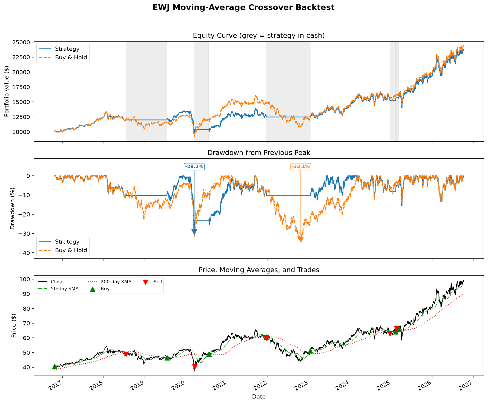
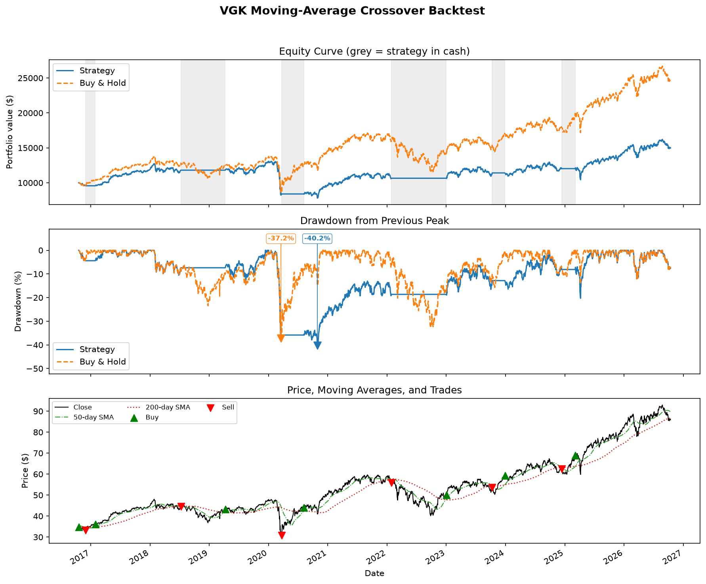

# Trading Strategy Lab

## Chapter 1: Does Trend-Following Work Everywhere?

A backtesting project that tests whether a simple moving-average trend-following strategy performs consistently across European, Japanese, and crypto markets — built with AI assistance, run only on paper money and historical data.

## Why I built this

I wanted to use the skills from my MSc in Finance to invest my own savings more systematically, and I wanted to explore what AI automation could realistically do for that process. Rather than risking real money on an idea, I decided to test it properly first: historical data, a paper trading account, and a documented method, before any capital is at risk.

## Research question and hypothesis

**Question:** Does a trend-following strategy work equally well in European, Japanese, and crypto markets?

**Hypothesis (written before testing):** The strategy would work best in Japan, because Japanese market trends tend to be longer and more gradual than in Europe or crypto.

## The strategy

A moving-average crossover strategy: long-only, cash-only (no shorting, no leverage, no margin). The position goes long when the short-term moving average is above the long-term moving average, and moves to cash otherwise.

| Market | Short/Long SMA | Cost per trade | Periods/year |
| --- | --- | --- | --- |
| EWJ (Japan ETF) | 50/200 days | 0.05% | 252 |
| VGK (Europe ETF) | 50/200 days | 0.05% | 252 |
| BTC-USD (main test) | 70/280 days | 0.25% | 365 |
| BTC-USD (second test) | 50/200 days | 0.25% | 365 |

BTC-USD trades 7 days a week, while EWJ and VGK only trade on the roughly 5-day trading week. The 70/280 window was chosen so the Bitcoin crossover spans the same amount of *calendar* time as the 50/200 window does for a 5-day market. The 50/200 run on Bitcoin is a second test, using the same window as the ETFs, to see how sensitive the result is to that choice.

## Method

- **Signal at close, trade at next open.** The crossover signal is computed using each day's closing price, but the resulting trade is only executed at the next day's open — no look-ahead bias.
- **Split- and dividend-adjusted data.** Price history is pulled with full adjustment for splits and dividends, so returns reflect total return, not just price change.
- **Costs on every trade.** A transaction cost is applied on every entry and every exit, not just once per position.
- **Buy-and-hold benchmark.** Each backtest is compared against a buy-and-hold benchmark starting from the same first entry day, so the comparison is apples-to-apples rather than against the full history.
- **Common comparison period.** To compare across markets fairly, results are also computed over a common window: 2021-10-08 to 2026-10-07. The start is the day after the first valid signal for BTC-USD's 70/280 window — the longest warm-up of the four runs, so it's the latest date any run can start from. The end is EWJ's last available data date — the earliest cutoff of the three instruments. Both ends of the window are set by this rule, not chosen to flatter a particular result.
- **Automated sanity test.** A pytest check confirms that a signal held "always on" reproduces the buy-and-hold result exactly — a basic correctness check on the backtest engine itself.
- **Regression check after code changes.** After later changes to the code, EWJ was re-run with the default 50/200 settings and the metrics matched the original run exactly (CAGR 9.02%, Sharpe 0.66, max drawdown -29.17%), confirming the change hadn't altered the backtest engine's behavior.
- **Design decisions fixed before seeing results.** The 50/200 default window, and Bitcoin's windows and costs, were fixed before running the backtests. The common comparison period was then defined by the warm-up/end-of-data rule above, after the fact, rather than picked to fit the results.

## Results

The charts below show each instrument's full price history (2016–2026); the comparison table after them is restricted to the common period (2021-10-08 to 2026-10-07) described above.

### EWJ (Japan) — full history, 2016–2026


### VGK (Europe) — full history, 2016–2026


### Comparison over the common period (2021-10-08 to 2026-10-07)

| Run | Strategy CAGR | Buy & Hold CAGR | CAGR Diff | Strategy Sharpe | Buy & Hold Sharpe | Sharpe Diff | Strategy Max DD | Buy & Hold Max DD | Trades | % Days Invested |
| --- | --- | --- | --- | --- | --- | --- | --- | --- | --- | --- |
| EWJ (50/200) | 13.18% | 10.35% | +2.84% | 0.85 | 0.62 | +0.23 | -15.74% | -29.58% | 9 | 74.64% |
| VGK (50/200) | 6.87% | 8.82% | -1.95% | 0.57 | 0.56 | +0.01 | -19.54% | -32.58% | 7 | 72.49% |
| BTC-USD (70/280) | 20.27% | 9.07% | +11.20% | 0.67 | 0.43 | +0.25 | -50.18% | -76.68% | 7 | 62.05% |
| BTC-USD (50/200) | 8.57% | 9.07% | -0.49% | 0.41 | 0.43 | -0.02 | -44.81% | -76.68% | 11 | 53.01% |

**Summary:**

- **Japan was the most consistent.** The strategy beat buy-and-hold on every measure in the table over the common period: higher return, better risk-adjusted return, and a much smaller drawdown.
- **Europe lagged on return but had smaller drawdowns.** The strategy trailed buy-and-hold by about 2% a year over the common period (and by more over the full 2016-2026 history), but roughly matched it on Sharpe and cut the drawdown considerably.
- **Bitcoin was fragile.** With its purpose-built 70/280 window, the strategy produced the largest gain of any run. With the same 50/200 window used for the ETFs, it underperformed buy-and-hold. That sensitivity to parameter choice is itself a finding — the result is not robust to the window.

**Conclusion: the hypothesis is partly confirmed.** The strategy worked most consistently in Japan, as expected. But it did not work "equally well" across markets — Europe was closer to a wash, and Bitcoin's results depended heavily on the chosen window.

## Key lesson: the test period matters as much as the strategy

Looking at the full available history (2016–2026) rather than only the common comparison window shows the limits of trend-following more clearly. The strategy sold near the bottom of the sudden March 2020 crash — a trend-following signal reacts to a move that has already happened, so it can exit right as a sharp drop is ending. It performed better in the slow, grinding 2022 bear market, where the trend had time to develop before the signal caught up. In short: this kind of strategy tends to help in slow declines and can hurt in sudden ones.

## Limitations

- **Short history.** Especially for Bitcoin, the available data only goes back to 2021, which limits how much can be concluded about longer-term robustness.
- **Cash earns 0% in the backtest.** Days spent out of the market are modeled as earning no return, which is conservative but not realistic — a real cash balance would earn some yield.
- **No taxes modeled.** Trading frequency and tax treatment would affect real after-tax returns and are not accounted for here.
- **Simple cost assumptions.** Transaction costs are modeled as a flat percentage per trade; real-world costs (spread, slippage, market impact) can vary.
- **Bitcoin data starts in 2021** in this dataset, versus 2016 for the ETFs, so the crypto results cover a shorter and less varied period.

This project is not ready for real money. It is a backtesting and paper-trading exercise only.

## Safety setup for the AI agent

Because an AI coding agent (Claude Code) was used to help build and run parts of this project, several controls were put in place before giving it any access to a brokerage account:

- **Paper trading keys only.** No live brokerage credentials are used anywhere in this project.
- **Local-scope Alpaca MCP server with limited toolsets.** The agent only has access to the tools needed for data and paper trading, not the full account surface.
- **Explicit deny rules** in `.claude/settings.json` block high-risk actions outright: updating account configuration, closing all positions, cancelling all orders, and placing or exercising options — regardless of what the agent is asked to do. The same file also denies reading `.env` or any `.env.*` file, so the agent cannot read API keys directly.
- **Manual permission mode.** The agent must ask before taking actions rather than running autonomously.
- **Keys kept out of the repository.** The backtest code reads its own Alpaca keys from a local, gitignored `.env` file. The Alpaca MCP server reads its keys from Claude Code's local user configuration instead. Both are stored outside the repository and are never committed.
- **AI output cross-checked**, not accepted at face value (see "Working with AI" below).

## Working with AI

Claude Code wrote most of the code in this project. I designed the strategy, the controls described above, and the evaluation approach, and I checked the agent's work rather than taking it on trust. That verification caught real issues along the way:

- A mismatch in historical data coverage between data feeds (IEX vs. the full SIP feed), which affected how far back usable data actually went.
- A "warm-up" period at the start of each price series, before the long moving average has enough days of data to be meaningful, which was distorting the metrics — understating returns and volatility, and showing buy-and-hold as only 93% invested — until it was explicitly excluded.
- The first "golden cross" in the data turning out to be an artifact of that same warm-up period rather than a genuine trend signal.

## Project structure and how to run it

```
src/trading_agent/
  data.py       # downloads daily bars from Alpaca (stocks and crypto)
  signals.py    # computes the moving-average crossover signal
  backtest.py   # runs the backtest (next-open execution, costs, metrics)
  charts.py     # builds the equity/drawdown/price charts
  compare.py    # runs all configured backtests over a common period and builds the comparison table
tests/
  test_backtest.py   # pytest sanity check
results/
  *_backtest.png, comparison.csv, comparison.md   # generated outputs
```

Setup:

```bash
cp .env.example .env   # fill in your own Alpaca PAPER trading keys
uv sync
```

On Windows (Command Prompt), copy the file instead with `copy .env.example .env`.

Typical workflow per symbol (example: EWJ):

```bash
uv run python -m trading_agent.data EWJ
uv run python -m trading_agent.signals EWJ --short-window 50 --long-window 200
uv run python -m trading_agent.backtest EWJ --short-window 50 --long-window 200 --cost 0.0005
uv run python -m trading_agent.charts EWJ
```

Run the cross-market comparison (it defaults to the common period described above, so no date flags are needed):

```bash
uv run python -m trading_agent.compare
```

Run the sanity test suite:

```bash
uv run pytest
```

## Next steps

Testing ICT (Inner Circle Trader) concepts and Quarterly Theory with the same rigor applied here: adjusted data, next-open execution, realistic costs, automated sanity checks, and hypotheses set before looking at results.

## Disclaimer

This is an educational project. All results come from backtests and paper trading only — no real money has been invested or is recommended based on this work. Nothing here is investment advice.
